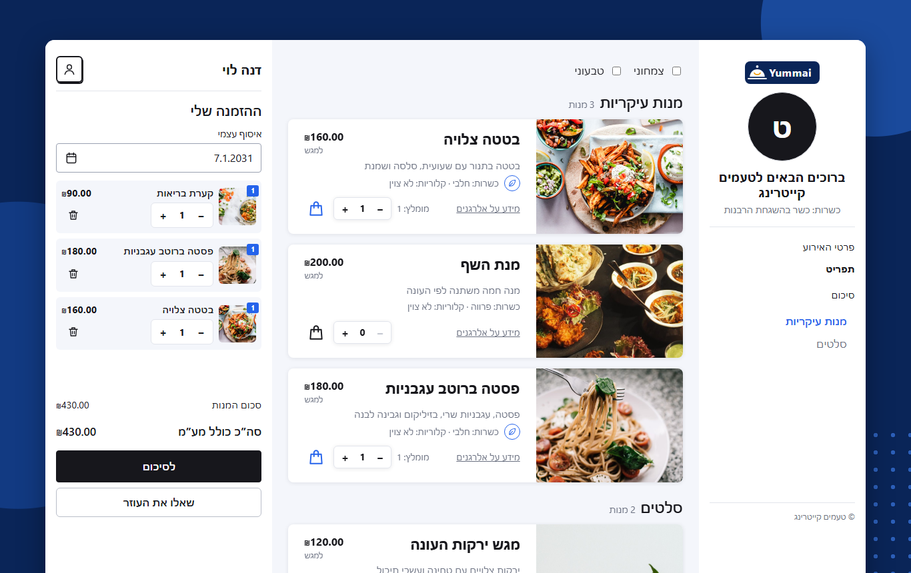
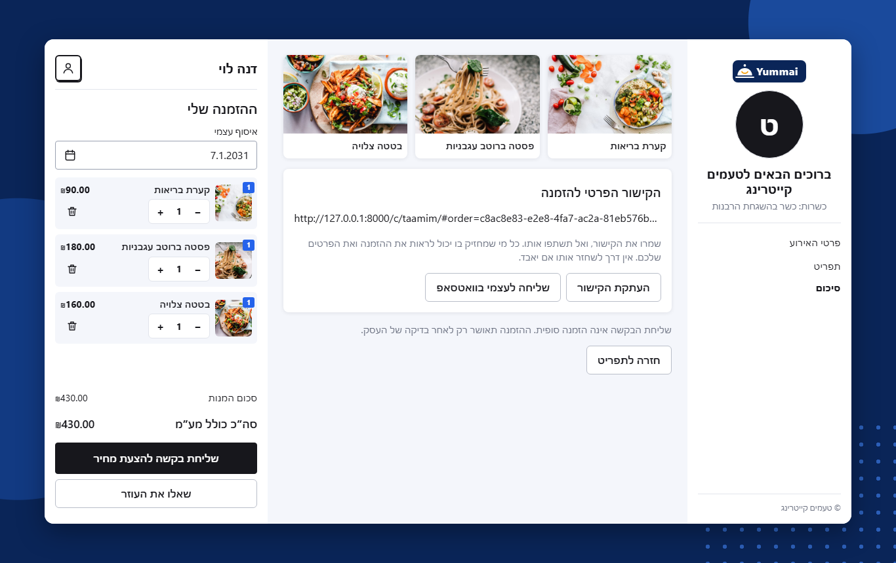
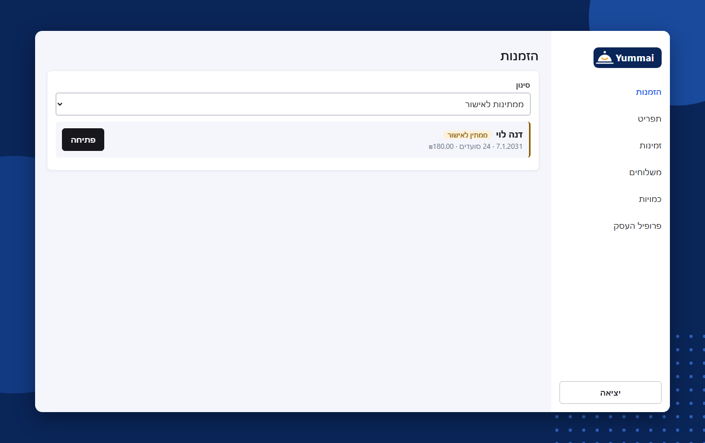
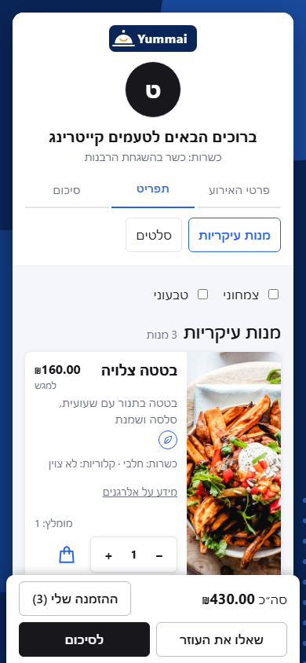

# AI Catering Platform

Hebrew ordering and management platform for **many catering businesses**. Each caterer gets a branded link. Customers use it to plan private events, pick dishes, get backend-calculated quantities and prices, and chat with an AI assistant whose suggested changes only apply after the customer approves them. Each caterer manages their own catalog and approves or rejects every quotation.

> Status: **built, not online**. All building phases are finished, and the test site is skipped for now. The AI chat needs `ANTHROPIC_API_KEY` and has only been tested with a scripted model. New-order emails need a Resend account and domain, and haven't been tested with the real provider. See `docs/DEPLOYMENT.md` to put it online, and `docs/` for the specs.

## Screenshots

Sample menu and made-up names.

| Customer menu | Order summary |
|---|---|
|  |  |

| Caterer dashboard | Phone |
|---|---|
|  |  |

## Phases

| Phase | What | Status |
|---|---|---|
| 0 | Project docs | Done |
| 1 | Project scaffolding | Done |
| 2 | Multi-caterer Hebrew specs | Done |
| 3 | Tenant foundation: separate data per caterer, caterer login | Done |
| 4 | Hebrew caterer dashboard: menu, availability, delivery, profile | Done |
| 5 | Customer ordering: event details, menu, prices, quote request | Done |
| 6 | Quote approval: the caterer approves or rejects, the customer sees the answer | Done |
| 7 | AI assistant: suggests changes that apply only when the customer approves | Done |
| 8 | Ready to go live: rate limits, security headers, Docker, deployment guide | Done |
| Design | New look with food photos, and the Yummai logo on every page | Done |
| Emails | Email to the caterer on a new order, with no customer details | Done |
| Test site | Online test version on Supabase and Railway | Skipped for now |
| Pilot | First real caterer | Not started |

## Stack

| Layer | Tech |
|---|---|
| Backend | Python 3.12+, FastAPI, Pydantic, SQLAlchemy |
| Frontend | Plain HTML, CSS, JavaScript (served by FastAPI) |
| Data | Supabase (Postgres, Storage, Auth for caterer logins) |
| Hosting | Railway (Dockerfile build) |
| Quality | pytest, Ruff, GitHub Actions |

## Repository layout

```
backend/        FastAPI app (api, core, models, schemas, services, repositories, agents) + tests
frontend/       customer/ and admin/ pages, css/, js/, assets/
database/       migrations/ (SQL, Supabase CLI format)
docs/           PRD, architecture, schema, API, AI agent, UX/UI, ADRs, open decisions
.github/        CI workflow
Dockerfile      Production image used by Railway
railway.json    Railway build/deploy config (healthcheck /health)
.env.example    Environment variable template
```

## Local development

Requires [uv](https://docs.astral.sh/uv/) (it installs a matching Python automatically).

```bash
cp .env.example .env          # fill values when needed; .env is git-ignored
cd backend
uv sync                       # install dependencies
uv run uvicorn app.main:app --reload
```

- API health: http://127.0.0.1:8000/health
- Customer UI: http://127.0.0.1:8000/c/{slug}/
- Admin UI: http://127.0.0.1:8000/admin/

### Tests and lint

```bash
cd backend
uv run ruff check .
uv run ruff format --check .
uv run pytest
```

Database tests need a disposable Postgres in `TEST_DATABASE_URL` (see `.env.example`); they skip locally without one and fail in CI. **The suite wipes that database.**

### Onboarding a caterer

Create the login in Supabase, then run `uv run python -m scripts.create_caterer --help` from `backend/`.

## Dependencies and why

| Package | Why |
|---|---|
| `fastapi` | Mandated web framework |
| `uvicorn[standard]` | ASGI server for FastAPI |
| `pydantic-settings` | Typed config from environment variables |
| `sqlalchemy` | ORM and queries (ADR 0002) |
| `psycopg[binary]` | Postgres driver |
| `pyjwt[crypto]` | Verifies Supabase login tokens |
| `httpx` | Calls Supabase Storage and Resend; also used by the test client |
| `anthropic` | Calls the model behind the AI assistant |
| `python-multipart` | Parses file uploads |
| `pytest` (dev) | Mandated test runner |
| `ruff` (dev) | Mandated linter/formatter |

## Branches and environments

| Branch | Purpose | Railway env | Supabase project |
|---|---|---|---|
| `main` | Production (default branch) | `production` | prod project |
| `dev` | Integration | `development` | dev project |

- Feature work → PR into `dev` (CI must pass).
- Release → PR `dev` → `main`.
- Production deploys are manual and need explicit approval.
- Each Railway environment holds its own variables from `.env.example`. **Never commit secrets.** The service-role key stays server-side.

## Railway / Supabase status

No Railway or Supabase project is connected yet. [docs/DEPLOYMENT.md](docs/DEPLOYMENT.md) is the step-by-step guide.

## Documentation

- [PRD](docs/PRD.md) · [Architecture](docs/ARCHITECTURE.md) · [Database schema](docs/DATABASE_SCHEMA.md) · [API contracts](docs/API_CONTRACTS.md)
- [AI agent design](docs/AI_AGENT_DESIGN.md) · [UX/UI spec](docs/UX_UI_SPEC.md) · [Open decisions](docs/OPEN_DECISIONS.md) · [ADRs](docs/ADR/)
