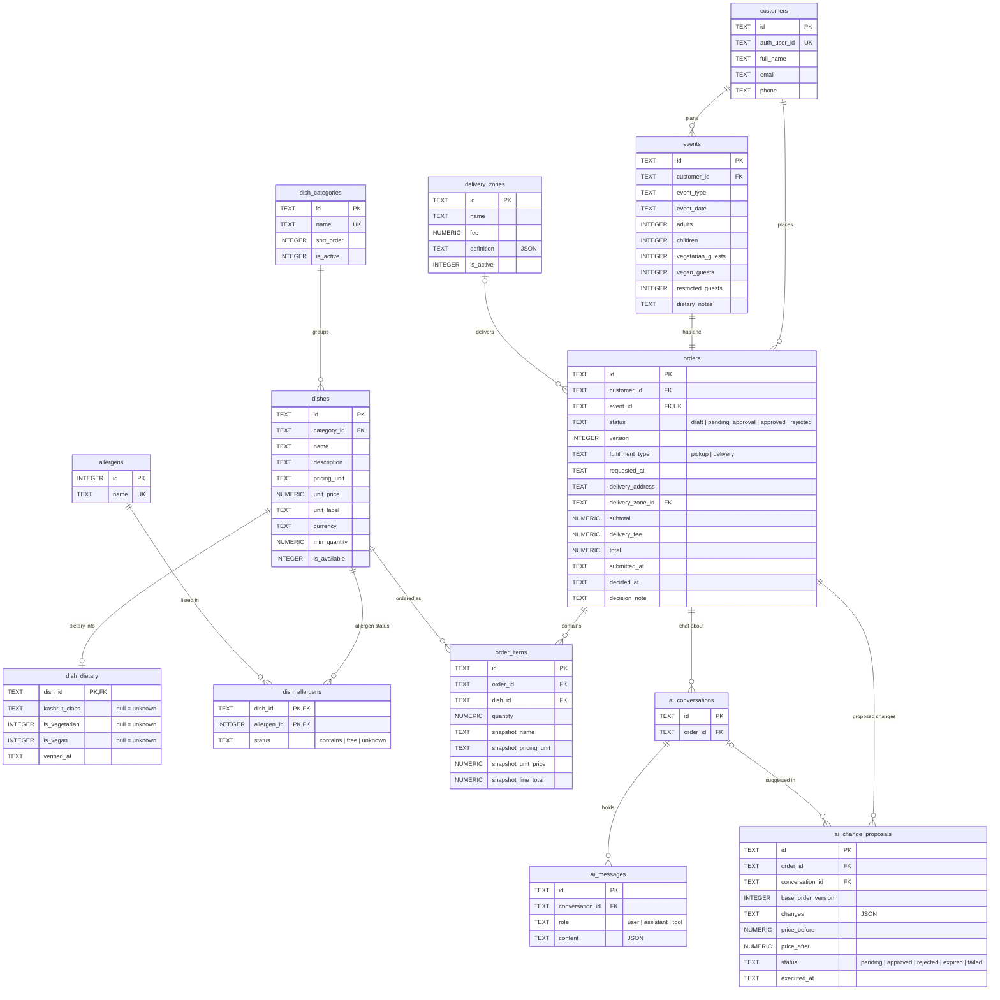

# ERD: SQLite course database

Mirrors `schema.sql`. GitHub renders the diagram below.

`time_slots` and `blocked_dates` stand alone (no foreign keys), so they are not drawn.
A missing `dish_allergens` row means "unknown", never "free".
