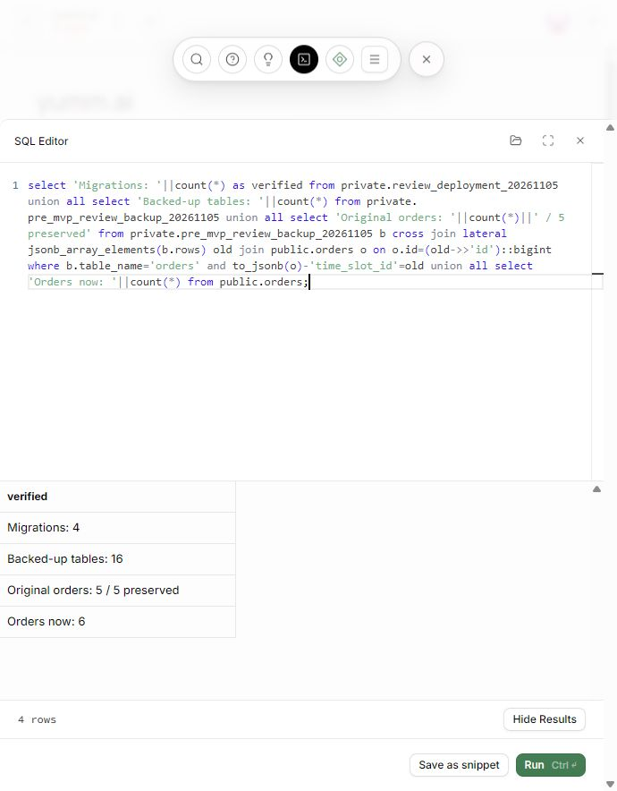
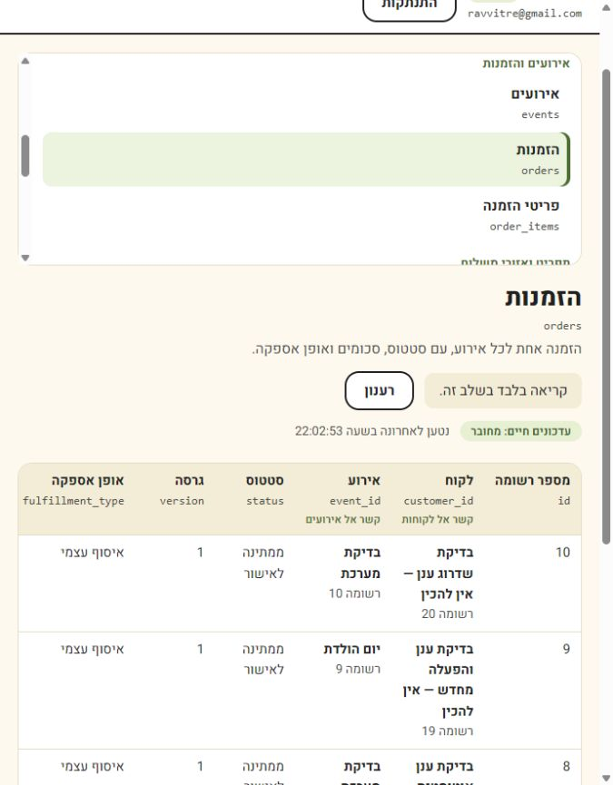

# Hosted upgrade verification — 5 November 2026

Target: **yumm.ai**, Frankfurt (`eu-central-1`), project `vbechymjcdlztoissafv`.

The four reviewed migrations (baseline, AI/availability foundation, catalog normalization, owner access) were applied together through the authenticated Supabase SQL editor. Claude Code independently reviewed and rehearsed the upgrade; the final storage policies were corrected to qualify `objects.name`, with owner/invalid-path/non-owner regression checks.

## Preservation

- A local private export preserved the eight core tables. A private in-database snapshot preserved all 16 original tables before any changes.
- A hosted rehearsal executed the complete upgrade and rolled back successfully.
- The actual transaction locked the original tables and compared every original row, accounting for the intentional catalog ID normalization. A mismatch would abort the transaction.
- All five original orders (1, 2, 3, 8, 9) retained their original fields and amounts. Both existing customer receipt payloads had identical before/after hashes.
- Independent REST comparisons confirmed the eight core tables immediately after deployment and after the first server restart.
- The four file hashes and deployment timestamps are recorded in a private deployment manifest. Backups, receipt tokens and credentials are not published in this repository.

## Restart and application checks

1. Restarted the matching local server after deploying the schema: process 66344 was replaced by 11844.
2. Existing order 8 returned its unchanged receipt. Replaying the submission reused the same order; a wrong receipt token returned 404.
3. Submitted synthetic order **10**, labelled “בדיקת שדרוג ענן — אין להכין”, for **ILS 281.00**. Two concurrent identical submissions returned 201/200 and one order; a changed payload with the same token returned 409.
4. Restarted the server again: process 11844 was replaced by 69408. Orders 8 and 10 still returned identical saved receipts, with `Cache-Control: no-store`. The database health check reported Supabase.
5. The user signed in as the existing owner. After reloading the admin from the restarted server, all six orders were visible, including the new order and all five originals. The realtime indicator showed connected; this does not establish cross-window event delivery.
6. A final hosted query compared the original order snapshot to current rows: **5 / 5 preserved**, **6 orders total**, **16 backed-up tables**, **4 applied migration records**.

## Scope and remaining work

- Cloud database changes are deployed; the application server is running locally on port 8766. This is not a public web-host deployment.
- Fresh installations have 17 MVP tables. The upgraded hosted project also retains eight legacy operations tables and their data; those are excluded from the MVP browser access/navigation.
- CLI authentication and historical migration reconciliation are not complete. Do not run an automatic CLI push/reset until that history is reconciled. The private deployment manifest is an audit record, not CLI migration history.
- The private table snapshots are not a full platform backup of Auth, Storage files, policies and sequences.
- Hosted image upload and cross-window realtime delivery were not retested in this pass. Storage policy behavior passed local PostgreSQL regression checks.
- AI execution/proposal approval and scheduling enforcement remain unimplemented schema foundations.
- The new synthetic order is deliberately retained as verification evidence and is clearly marked not to prepare.
