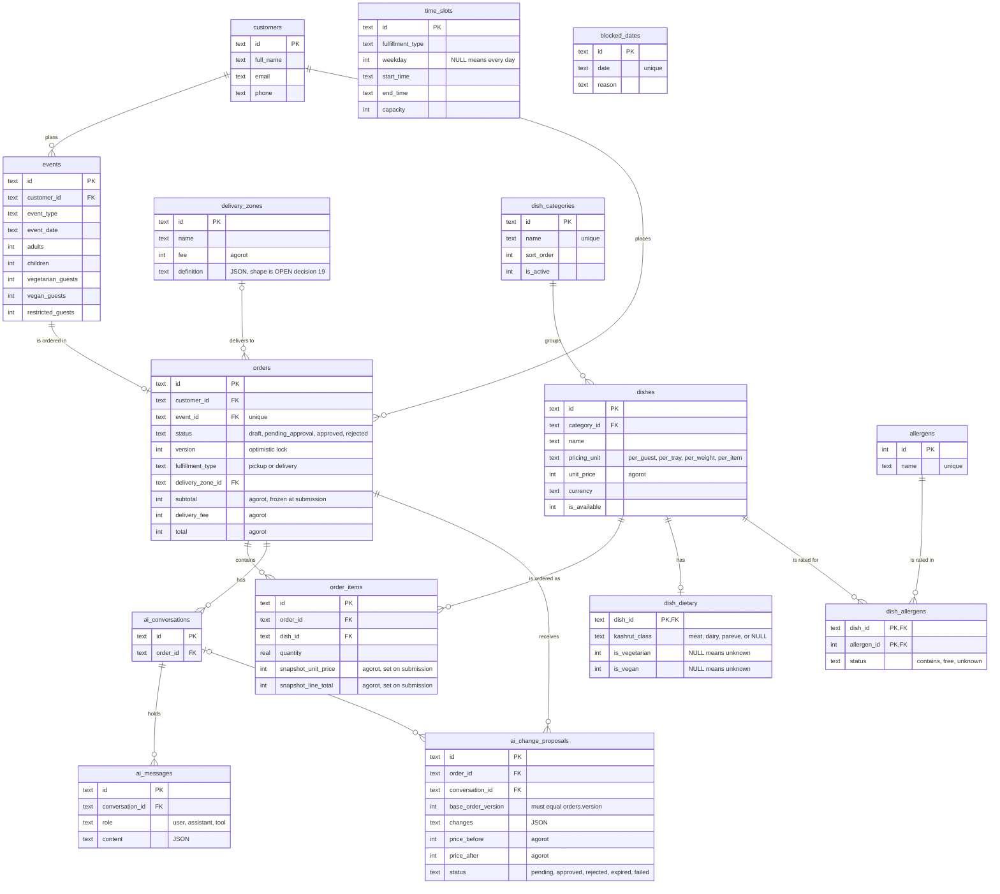

# Database ERD (SQLite prototype)

Entity-relationship diagram of `database/migrations/0001_initial.sql`. Only keys and the columns that carry
business meaning are shown; the migration file is the full definition. Design notes are in
[DATABASE_SCHEMA.md](DATABASE_SCHEMA.md) and [ADR 0005](ADR/0005-sqlite-prototype-database.md).

## Reading the diagram

- `time_slots` and `blocked_dates` have no foreign keys. They are availability rules that the
  backend checks against an order's requested date and time.
- **No row means unknown.** A dish with no `dish_allergens` row for an allergen has unknown status for it,
  and `NULL` in `dish_dietary` means not provided. Neither is ever treated as "free" or "no".
- **Price snapshot.** While an order is a `draft`, prices are read live from `dishes`. On submission
  the `snapshot_*` columns on `order_items` and the totals on `orders` become authoritative.
- **One pending proposal per order** is enforced by a partial unique index on `ai_change_proposals`.
- Deleting an order cascades to its items, conversations, messages and proposals. Deleting a dish
  cascades to its dietary and allergen rows.
