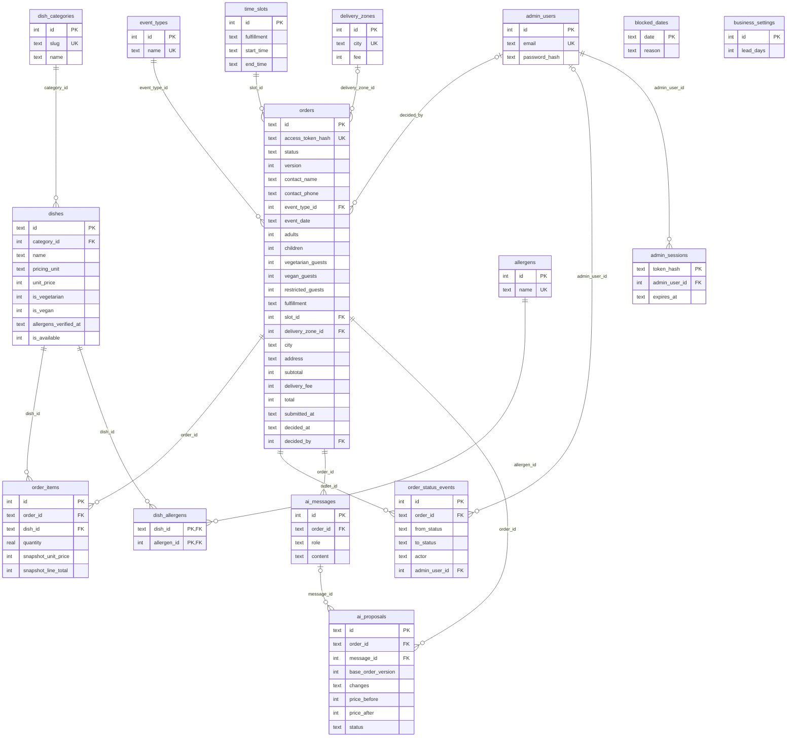

# Database Schema (SQLite)

Status: **Draft v0.2, proposal.** Replaces the v0.1 Postgres draft. Source of truth for the DDL: [`database/schema.sql`](../database/schema.sql). Demo data: [`database/seed.sql`](../database/seed.sql), generated from `frontend/js/customer/mock-backend.js` (placeholder business data).

Derived from the chosen UI (PR #24): `mock-backend.js`, `store.js`, `views/*`, plus `API_CONTRACTS.md`.

## ERD

Key columns only; the full column lists are in the tables below.



`blocked_dates` and `business_settings` have no relationships: the service checks the order's date against them.

## Decision: SQLite, and how to move to Postgres later

The database is **SQLite** (Jonathan's instruction). [ADR 0002](ADR/0002-supabase-postgres-sqlalchemy.md) still says Supabase Postgres via SQLAlchemy; it has not been updated and should be superseded by a new ADR before the first migration lands.

The schema avoids SQLite-only tricks so the move stays mechanical:

| SQLite (now) | Postgres (later) |
|---|---|
| `INTEGER` agorot | `integer` (keep agorot) or `numeric(10,2)` (divide by 100) |
| `TEXT` ids that hold a uuid | `uuid` |
| `TEXT` dates / timestamps (ISO-8601 UTC) | `date` / `timestamptz` |
| `INTEGER` 0/1 booleans | `boolean` |
| `CHECK (x IN (...))` enums | `CHECK` or Postgres enum types |
| `TEXT` with `json_valid` | `jsonb` |
| `INTEGER PRIMARY KEY` | `bigint generated always as identity` |
| `strftime(...)` defaults | `now()` |
| `STRICT`, `WITHOUT ROWID` | drop |

Rules that keep it portable: all access goes through SQLAlchemy 2.x (no raw SQLite functions in services), money stays integer, and each schema change is a numbered SQL file in `database/migrations/`. Copy data with one script per table (`INSERT ... SELECT`), then add RLS if Supabase Auth/Storage is used. Two behaviours differ: SQLite needs `PRAGMA foreign_keys = ON` on **every** connection, and it has no row locks (`SELECT ... FOR UPDATE`). Proposal approval is safe anyway because it uses `UPDATE orders SET version = version + 1 WHERE id = ? AND version = ?` and checks the affected row count; that statement works unchanged on Postgres.

## Conventions

- **Money:** integer agorot. `fmtMoney` in the frontend divides by 100. Currency is ILS (OPEN #17).
- **Dates:** `YYYY-MM-DD`; times `HH:MM`; timestamps ISO-8601 UTC.
- **Unknown is not "no":** `NULL` in a dietary flag or allergen data means unknown and is never shown as safe.
- **Ids:** `TEXT` for entities exposed in URLs or the API (orders, proposals, dishes); `INTEGER` for configuration tables.
- **No triggers.** The service sets `updated_at` and bumps `orders.version`.

## Tables

### Configuration

| Table | Columns | Notes |
|---|---|---|
| `business_settings` | `id` (always 1), `lead_days`, `updated_at` | Minimum days from today to the event (mock: 2, OPEN #5) |
| `event_types` | `id`, `name` unique, `sort_order`, `is_active` | Required on the order form; owner-editable |
| `delivery_zones` | `id`, `city` unique, `fee`, `is_active` | Fee per city (OPEN #19 may change the definition) |
| `time_slots` | `id`, `fulfillment` (pickup/delivery), `start_time`, `end_time`, `is_active` | The customer picks a window, not an exact time. No capacity column until OPEN #5 |
| `blocked_dates` | `date` PK, `reason` | Closed dates |

### Owner login

| Table | Columns | Notes |
|---|---|---|
| `admin_users` | `id`, `email` unique, `password_hash`, `display_name`, `is_active`, `created_at`, `last_login_at` | Hash only. No seeded user: create the owner with a script |
| `admin_sessions` | `token_hash` PK, `admin_user_id`, `created_at`, `expires_at` | Hash of the cookie value; the raw token is never stored |

### Catalog

| Table | Columns | Notes |
|---|---|---|
| `dish_categories` | `id`, `slug` unique, `name` unique, `sort_order`, `is_active` | `slug` is the key the frontend uses (`salads`, `mains`...) |
| `dishes` | `id`, `category_id`, `name`, `description`, `image_path`, `pricing_unit`, `unit_price`, `qty_per_guest`, `step`, `kashrut`, `is_vegetarian`, `is_vegan`, `allergens_verified_at`, `is_available`, `sort_order`, `created_at`, `updated_at` | See below |
| `allergens` | `id`, `name` unique | |
| `dish_allergens` | `dish_id`, `allergen_id` (PK both) | Allergens the dish **contains** |

`dishes` details:

- `pricing_unit`: `tray` · `kg` · `item` · `guest`. `guest` is the new unit (drinks): quantity equals the number of guests.
- `qty_per_guest` is the mock's `perGuest`; `step` is the quantity increment. Both are nullable and **placeholders** until the quantity rules are decided (OPEN #3). When `step` is NULL the app uses its default (0.5 for kg, else 1).
- `kashrut`, `is_vegetarian`, `is_vegan` are nullable (NULL = not provided). A vegan dish must be vegetarian (CHECK).
- **Allergens** use three states, matching the mock (`[...]`, `[]`, `null`): `allergens_verified_at IS NULL` means unknown; set with rows in `dish_allergens` means contains those; set with no rows means verified free. This replaces the v0.1 `allergen_status` enum and `free` rows.

### Orders

| Table | Columns |
|---|---|
| `orders` | see below |
| `order_items` | `id`, `order_id`, `dish_id`, `quantity`, `snapshot_name`, `snapshot_pricing_unit`, `snapshot_unit_price`, `snapshot_line_total`; UNIQUE(`order_id`, `dish_id`) |
| `order_status_events` | `id`, `order_id`, `from_status` (NULL = creation), `to_status`, `actor` (customer/owner/system), `admin_user_id`, `note`, `created_at` |

`orders`:

| Group | Columns | Notes |
|---|---|---|
| Identity | `id`, `access_token_hash`, `status`, `version` | `status`: draft · pending_approval · approved · rejected. `version` is +1 on every mutation |
| Contact | `contact_name`, `contact_phone` | No accounts (OPEN #1), so contact lives on the order. NULL only while `draft` |
| Event | `event_type_id`, `event_date`, `adults`, `children`, `vegetarian_guests`, `vegan_guests`, `restricted_guests`, `dietary_notes` | `adults >= 1`. Event type is required |
| Fulfillment | `fulfillment`, `slot_id`, `slot_start`, `slot_end`, `delivery_zone_id`, `city`, `address` | Delivery needs zone + city + address; pickup must have none of them. Slot times and city are copied at creation, so editing a slot or zone does not rewrite old orders |
| Prices | `subtotal`, `delivery_fee`, `total` | NULL while draft (priced live from `dishes`); frozen on submit; `total = subtotal + delivery_fee` |
| Decision | `submitted_at`, `decided_at`, `decided_by`, `owner_note` | `owner_note` is shown on the status page |
| Audit | `created_at`, `updated_at` | |

How the pieces behave:

- **Access token.** A random token (at least 32 bytes) is created with the draft and appears in the customer's status link (`?token=...`; the exact route is up to the backend). Only its sha256 is stored, so a database leak does not expose customers' names, phones and addresses. The raw token is returned once, on creation.
- **Price snapshot.** While `draft`, `order_items` has no snapshot and prices come live from `dishes`. On submit, the four `snapshot_*` columns are filled in the same transaction as `orders.subtotal/delivery_fee/total`; from then on they are the only source of truth. A CHECK forces the four columns to be all NULL or all set.
- **Constraints worth knowing.** A non-draft order must have contact, `submitted_at` and prices; `decided_at` is set exactly when the status is approved or rejected.
- **Not enforced in SQL (service rules):** the slot matches the fulfillment type; the date respects `lead_days` and `blocked_dates`; the dietary counts fit in the guest total (OPEN #4); legal status transitions.

### AI assistant

| Table | Columns | Notes |
|---|---|---|
| `ai_messages` | `id`, `order_id`, `role` (user/assistant/tool), `content`, `created_at` | One conversation per order. May contain personal data |
| `ai_proposals` | `id`, `order_id`, `message_id`, `base_order_version`, `changes` (JSON), `price_before`, `price_after`, `status`, `created_at`, `decided_at`, `executed_at` | `status`: pending · approved · rejected · expired · failed |

`changes` is a JSON list of `{op, dish_id, quantity}` with `op` in `add_item`, `set_quantity`, `remove_item`. A proposal executes only if `status = 'pending'` and `base_order_version = orders.version`; otherwise it becomes `expired`. `executed_at` is set once, so approving twice cannot apply twice. `price_before` / `price_after` are computed by the backend, never by the model (ADR 0003). `ai_conversations` from v0.1 is gone: with one conversation per order it only added a join.

## Status transitions

| From | To | Actor | Event row |
|---|---|---|---|
| (none) | draft | customer | `from_status = NULL` |
| draft | pending_approval | customer | |
| pending_approval | approved | owner | `admin_user_id` set |
| pending_approval | rejected | owner | `admin_user_id` set |

Proposals can only execute while the order is `draft`.

## Revenue

Out of scope as a table on purpose. Revenue is a query over approved orders, so there is nothing to keep in sync:

```sql
-- Agorot per month, by event date
SELECT substr(event_date, 1, 7) AS month, count(*) AS orders, sum(total) AS revenue
FROM orders WHERE status = 'approved' GROUP BY month ORDER BY month;
```

Which date to group by is an open question (below).

## Out of scope on purpose

Out of scope on purpose: employees, ingredients, inventory.

Also not modelled yet: payments (OPEN #2), customer accounts (OPEN #1), notifications (OPEN #13), cancellation and revisions (OPEN #7), quantity rules (OPEN #3, only the placeholder `qty_per_guest` and `step` exist), and slot or daily capacity (OPEN #5).

## Open questions

1. **Revenue date:** count revenue by `event_date` or by approval date (`decided_at`)? This changes which month a December event approved in November lands in.
2. **AI message retention:** how long do we keep `ai_messages`? Customers can type names, phones, addresses and health details. Options: delete after N days from the event, or delete with the order.
3. **Dietary counts (OPEN #4):** are vegetarians, vegans and restricted guests counted **inside** adults + children, or in addition? The mock rejects the order when the three counts add up to more than the total. The schema does not enforce it until this is decided.

## Where this differs from `API_CONTRACTS.md`

The contract predates PR #24 and should be reconciled before Phase 2:

- Orders need `contact_name`, `contact_phone`, `slot_id` (instead of `requested_at`), `city`, `restricted_guests` and a required `event_type_id`.
- `POST /api/orders` must return the status-link token once; customer reads then use `?token=` instead of a customer id.
- Money is integer agorot, not decimal strings (`"1200.00"`).
- Add `GET /api/availability` fields for `lead_days`, delivery zones with fees, and `unit: guest`.
- Add `POST /api/admin/login` and `POST /api/admin/logout`, and the admin CRUD for `event_types`.
