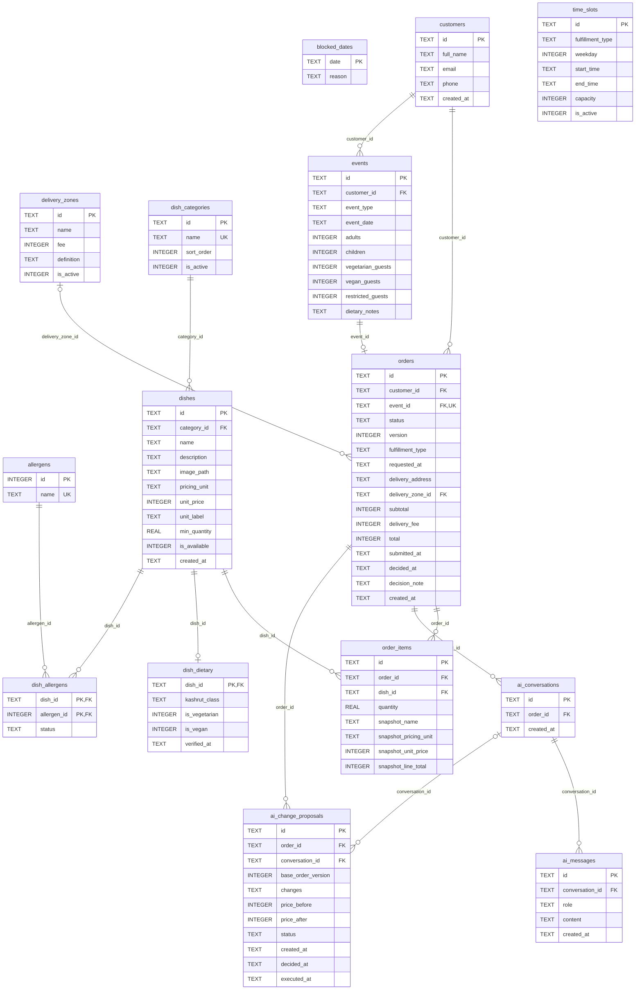

# SQLite ERD

Entity-relationship diagram of `backend/app/db/schema.sql`, generated from the real database (`PRAGMA table_info` / `foreign_key_list`). GitHub renders the diagram below.

Notation: `PK` primary key, `FK` foreign key, `UK` unique. Line ends: `||` exactly one, `|o` zero or one, `o{` zero or many.

## Notes
- One order per event (`orders.event_id` is unique); an order belongs to one customer.
- `order_items` is unique on (`order_id`, `dish_id`). Its `snapshot_*` columns freeze name and price on submission.
- `dish_dietary` is 1:1 with `dishes`; `dish_allergens` is the many-to-many link to `allergens`. A missing row means unknown.
- At most one `pending` row per order in `ai_change_proposals` (partial unique index, not shown as a relationship).
- Money is stored as integer agorot; dates are ISO-8601 text.
- `delivery_zones` is optional on an order; `time_slots` and `blocked_dates` stand alone (availability rules, no foreign keys).
