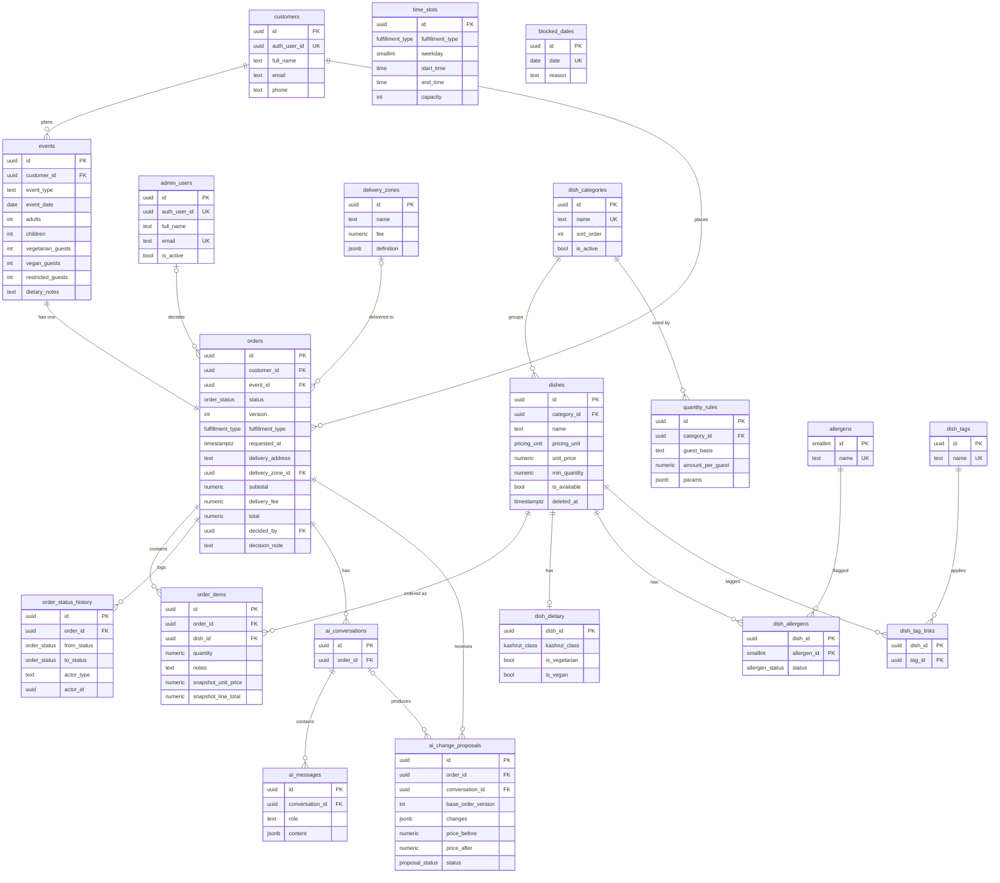

# Entity Relationship Diagram

Matches `database/migrations/20261102000000_initial_schema.sql`. Renders on GitHub (Mermaid).
`business_settings` is a single-row config table and has no relations, so it is omitted.

`time_slots` and `blocked_dates` have no foreign keys. Orders are checked against them in backend logic.
