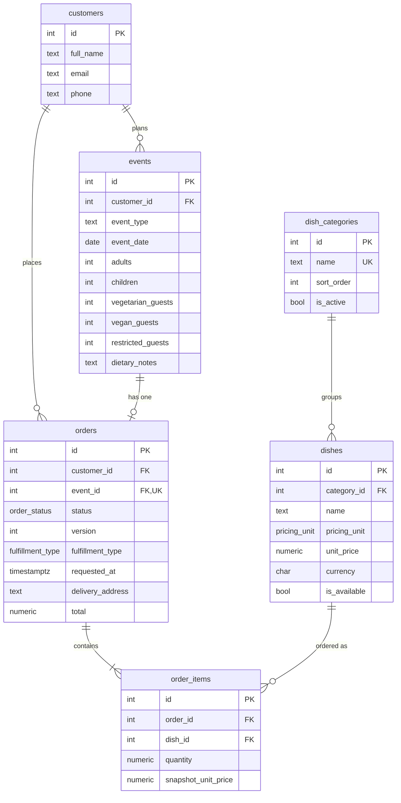

# ERD: implemented tables

Tables that exist in code today (`backend/app/models/`). Column detail and the full planned schema: [DATABASE_SCHEMA.md](DATABASE_SCHEMA.md).

## What each table holds

| Table | Holds | Key columns |
|---|---|---|
| `customers` | One row per person who orders: contact details. | `full_name`, `email`, `phone` |
| `events` | The occasion being catered: what, when, and for how many guests (including dietary counts). A customer can have many events. | `customer_id`, `event_type`, `event_date`, `adults`, `children`, `vegetarian_guests`, `vegan_guests`, `restricted_guests`, `dietary_notes` |
| `dish_categories` | Menu sections (e.g. salads, mains, desserts) and their display order. | `name` (unique), `sort_order`, `is_active` |
| `dishes` | The menu: each dish, its category, how it's priced (per guest / tray / weight / item) and its price. | `category_id`, `name`, `pricing_unit`, `unit_price`, `currency`, `min_quantity`, `is_available` |
| `orders` | The order for one event: status (`draft` → `pending_approval` → `approved`/`rejected`), pickup or delivery, requested time, and totals computed by the backend. `version` goes up on every change so AI proposals can detect a stale order. | `customer_id`, `event_id` (unique), `status`, `version`, `fulfillment_type`, `requested_at`, `delivery_address`, `subtotal`, `delivery_fee`, `total` |
| `order_items` | The lines of an order: which dish and how much. While the order is a draft, prices come live from `dishes`; when it's submitted, `snapshot_*` freezes the name and price so later menu changes don't alter it. | `order_id`, `dish_id`, `quantity`, `snapshot_name`, `snapshot_unit_price`, `snapshot_line_total` |

## Rules enforced by the database
- Every foreign key is enforced (SQLite needs `PRAGMA foreign_keys=ON`, set in `app/core/db.py`).
- An event has at least one guest (`adults + children > 0`), and no guest count is negative.
- An order belongs to exactly one event (`orders.event_id` is unique).
- A delivery order must have `delivery_address`.
- `order_items.quantity > 0`, and each dish appears once per order (`UNIQUE(order_id, dish_id)`).
- `dishes.unit_price >= 0`.

## Not built yet
`dish_dietary`, `allergens`, `dish_allergens`, `delivery_zones`, `time_slots`, `blocked_dates`, `ai_conversations`, `ai_messages`, `ai_change_proposals`. Because `delivery_zones` doesn't exist yet, `orders.delivery_zone_id` is left out for now.
