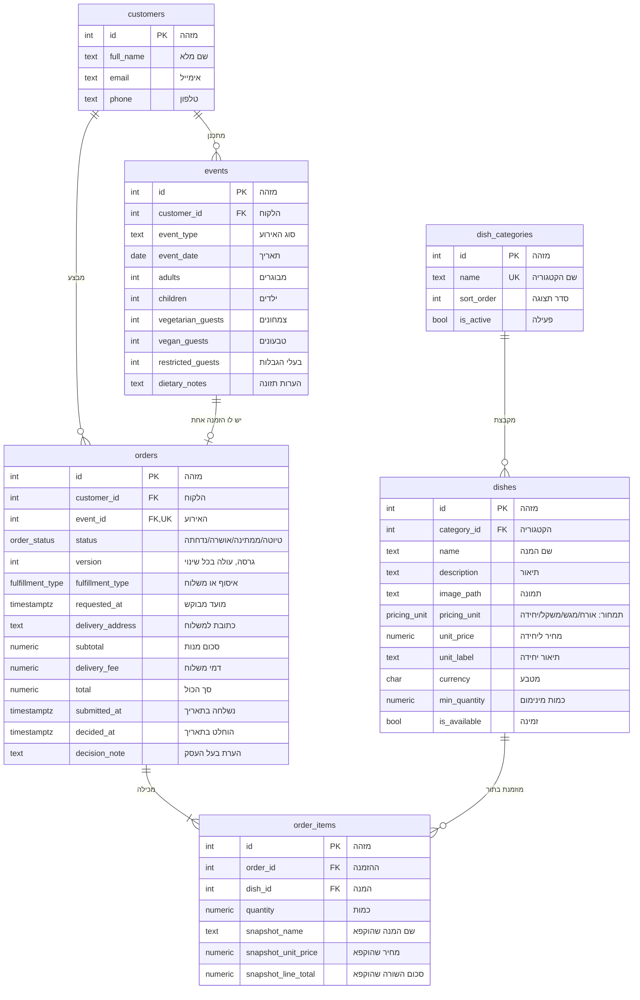

# ERD — תרשים הטבלאות הקיימות

ERD (Entity Relationship Diagram) = תרשים ישויות וקשרים: אילו טבלאות יש ואיך הן מחוברות.
כאן מופיעות רק הטבלאות שכבר קיימות בקוד (`backend/app/models/`). הסכמה המלאה המתוכננת: [DATABASE_SCHEMA.md](DATABASE_SCHEMA.md).

**איך לקרוא את התרשים:** לקוח מתכנן אירועים. לכל אירוע יש לכל היותר הזמנה אחת. הזמנה מכילה שורות הזמנה, וכל שורה מצביעה על מנה אחת מתוך קטגוריה.

## מה יש בכל טבלה

| טבלה | מה היא שומרת | עמודות עיקריות |
|---|---|---|
| `customers` (לקוחות) | שורה לכל אדם שמזמין: פרטי קשר. | `full_name`, `email`, `phone` |
| `events` (אירועים) | האירוע שמזמינים אליו קייטרינג: סוג, תאריך, מספר אורחים (כולל צמחונים, טבעונים ובעלי הגבלות). ללקוח יכולים להיות כמה אירועים. | `customer_id`, `event_type`, `event_date`, `adults`, `children`, `vegetarian_guests`, `vegan_guests`, `restricted_guests`, `dietary_notes` |
| `dish_categories` (קטגוריות) | חלקי התפריט (סלטים, עיקריות, קינוחים) וסדר התצוגה שלהם. | `name` (ייחודי), `sort_order`, `is_active` |
| `dishes` (מנות) | התפריט: כל מנה, הקטגוריה שלה, שיטת התמחור (לאורח / למגש / לפי משקל / ליחידה) והמחיר. | `category_id`, `name`, `pricing_unit`, `unit_price`, `currency`, `min_quantity`, `is_available` |
| `orders` (הזמנות) | ההזמנה של אירוע אחד: סטטוס (`draft` טיוטה → `pending_approval` ממתינה לאישור → `approved` אושרה / `rejected` נדחתה), איסוף או משלוח, מועד מבוקש, וסכומים שהשרת מחשב. `version` עולה בכל שינוי, כדי שהצעות של ה-AI יזהו הזמנה שהשתנתה בינתיים. | `customer_id`, `event_id` (ייחודי), `status`, `version`, `fulfillment_type`, `requested_at`, `delivery_address`, `subtotal`, `delivery_fee`, `total` |
| `order_items` (שורות הזמנה) | מה יש בהזמנה: איזו מנה ובאיזו כמות. כל עוד ההזמנה בטיוטה, המחיר נלקח בזמן אמת מ-`dishes`. כשההזמנה נשלחת, עמודות `snapshot_*` "מקפיאות" את השם והמחיר, כך ששינויים בתפריט לא ישנו אותה. | `order_id`, `dish_id`, `quantity`, `snapshot_name`, `snapshot_unit_price`, `snapshot_line_total` |

## כללים שמסד הנתונים אוכף בעצמו
- כל קשר בין טבלאות נבדק: אי אפשר, למשל, ליצור הזמנה ללקוח שלא קיים. ב-SQLite זה דורש `PRAGMA foreign_keys=ON`, שמוגדר ב-`app/core/db.py`.
- לאירוע יש לפחות אורח אחד (`adults + children > 0`), ואף מספר אורחים לא שלילי.
- להזמנה יש בדיוק אירוע אחד (`orders.event_id` ייחודי).
- הזמנה במשלוח חייבת כתובת (`delivery_address`).
- כמות בשורת הזמנה גדולה מ-0 (`quantity > 0`), וכל מנה מופיעה פעם אחת בהזמנה (`UNIQUE(order_id, dish_id)`).
- מחיר מנה לא שלילי (`unit_price >= 0`).

## עוד לא נבנה
`dish_dietary`, `allergens`, `dish_allergens`, `delivery_zones`, `time_slots`, `blocked_dates`, `ai_conversations`, `ai_messages`, `ai_change_proposals`. מכיוון שאין עדיין `delivery_zones`, העמודה `orders.delivery_zone_id` הושמטה בינתיים.
