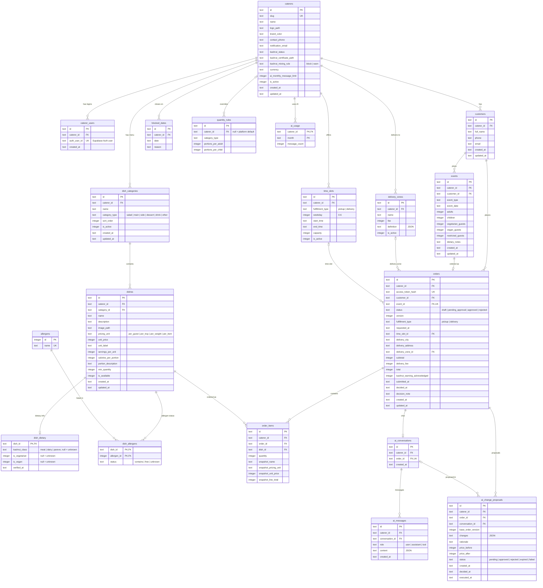

# Entity relationship diagram

The Postgres schema from `supabase/migrations/20261105000000_schema.sql`.
Column details and rules are in `DATABASE_SCHEMA.md`.

Notes:

- Every table except `allergens` and `dish_dietary`/`dish_allergens` (which hang off
  `dishes`) has a `caterer_id`. To keep the diagram readable, only the top-level
  tables draw a line to `caterers`; the rest reach it through their parent, and
  composite foreign keys on `(caterer_id, ...)` keep the whole chain in one caterer.
- Money columns are integer hundredths (12.50 is 1250). Ids are 32 hex characters.
- `quantity_rules.caterer_id` is nullable: null is the platform default.

