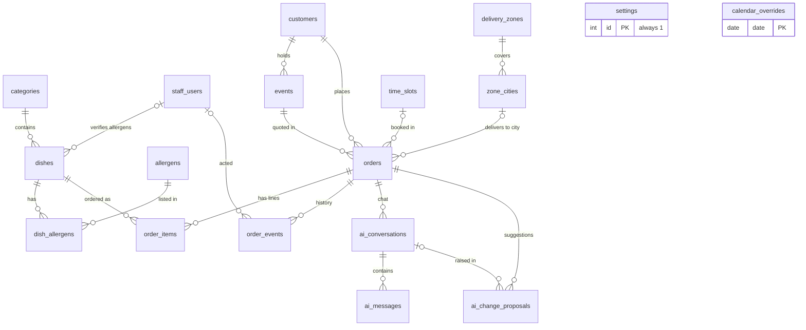
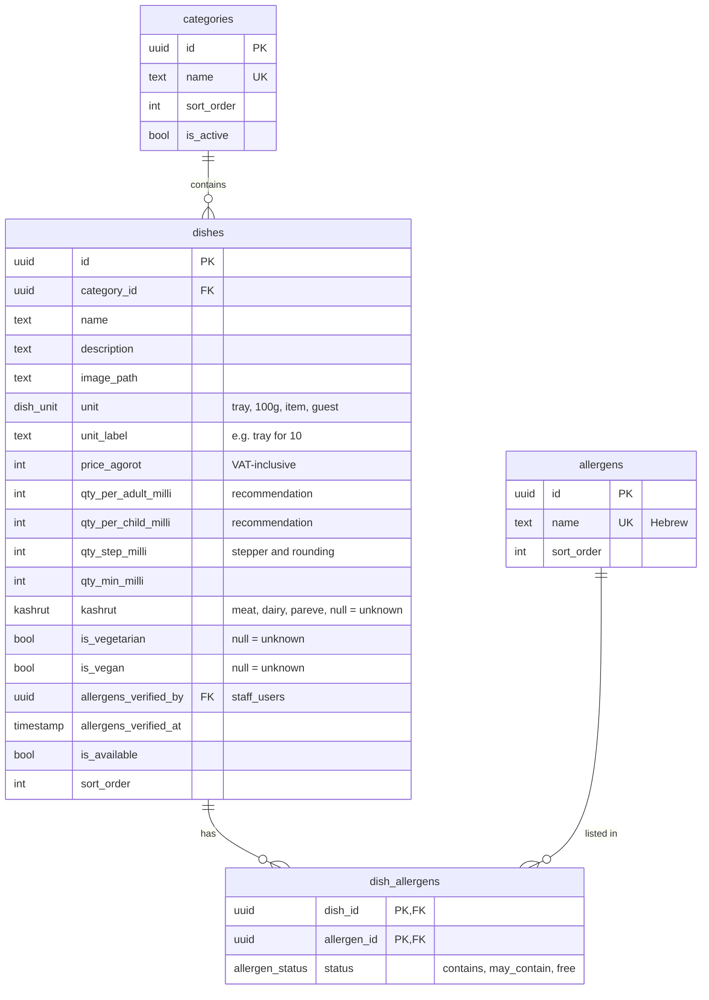
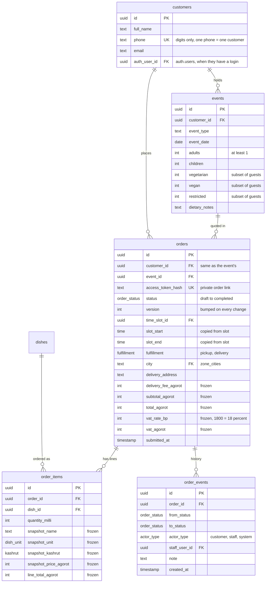
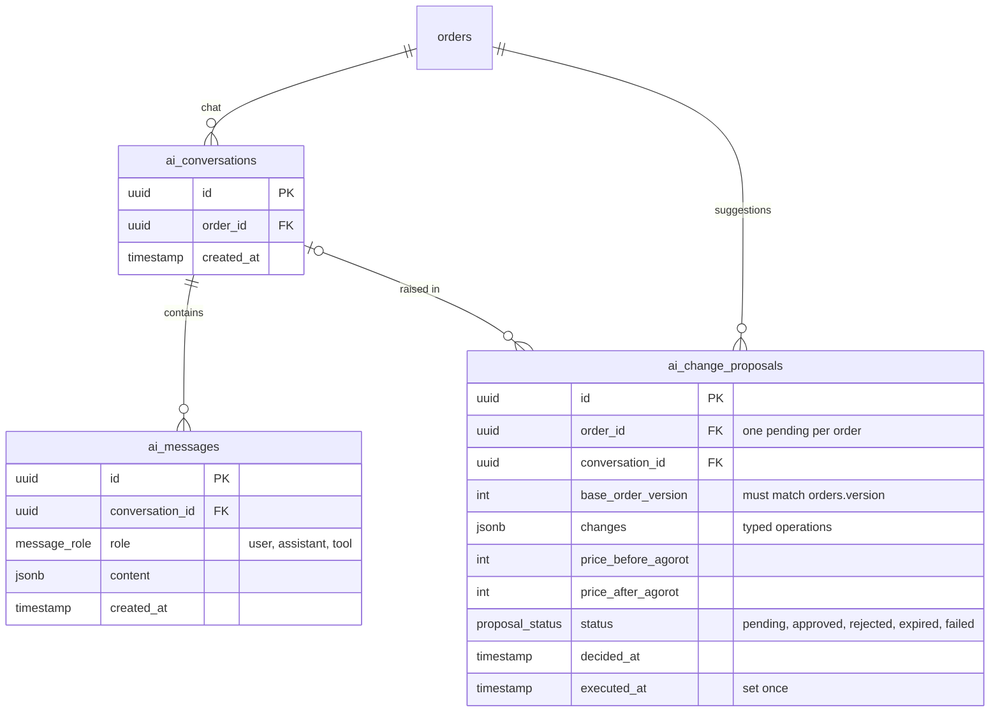
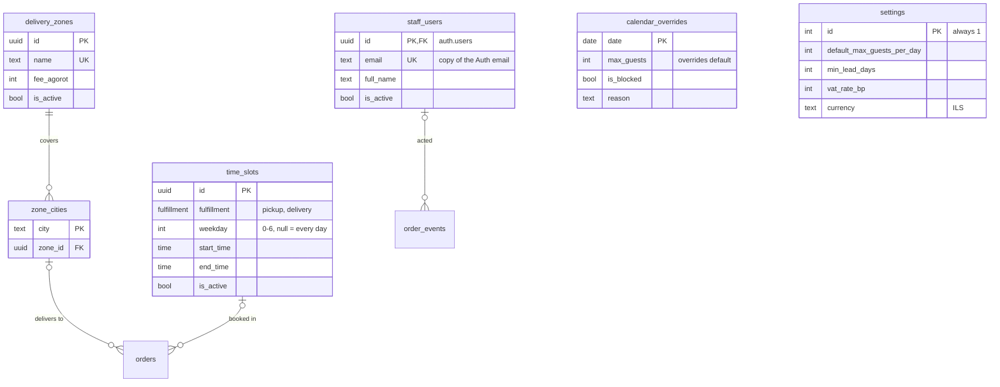

# Entity-relationship diagram

Diagrams for the schema in [`DATABASE_SCHEMA.md`](DATABASE_SCHEMA.md) (v0.4, live in Supabase; SQL in `supabase/migrations/`). Column types such as `order_status` and `kashrut` are Postgres enum types. Column conventions:

- `*_agorot`: money in whole agorot, VAT-inclusive (₪85.50 = `8550`).
- `*_milli`: quantity in thousandths of the dish unit (3 trays = `3000`).
- Empty kashrut / vegetarian / vegan means **unknown**; a missing `dish_allergens` row means **unknown**, never allergen-free.
- `PK` primary key · `FK` foreign key · `UK` unique. `||--o{` = one required parent, zero or more children; `|o--o{` = optional parent.

## Overview (relationships only)

Every line is a foreign key. `orders` is the centre; each order belongs to one `events` row, and an event can have several orders. `settings` and `calendar_overrides` have no foreign keys; the backend reads them for the daily guest limit.

## Menu

One unit and one price per dish; weight is priced per 100 g. Empty `qty_*` columns mean no recommended amount.

## Customers and orders

Statuses: `draft` → `pending_approval` → `approved` / `rejected`, plus `cancelled` and `completed`; every change writes an `order_events` row. `frozen` columns are filled at submission.

## AI assistant

A suggestion runs only if `base_order_version` still matches `orders.version`, and only once (`executed_at`). Chat messages are deleted 90 days after the event; suggestions stay.

## Delivery, availability and staff

Daily guest limit = `calendar_overrides.max_guests` if set, else `settings.default_max_guests_per_day`. A blocked date is an override with `is_blocked`. Time slots have no capacity.

