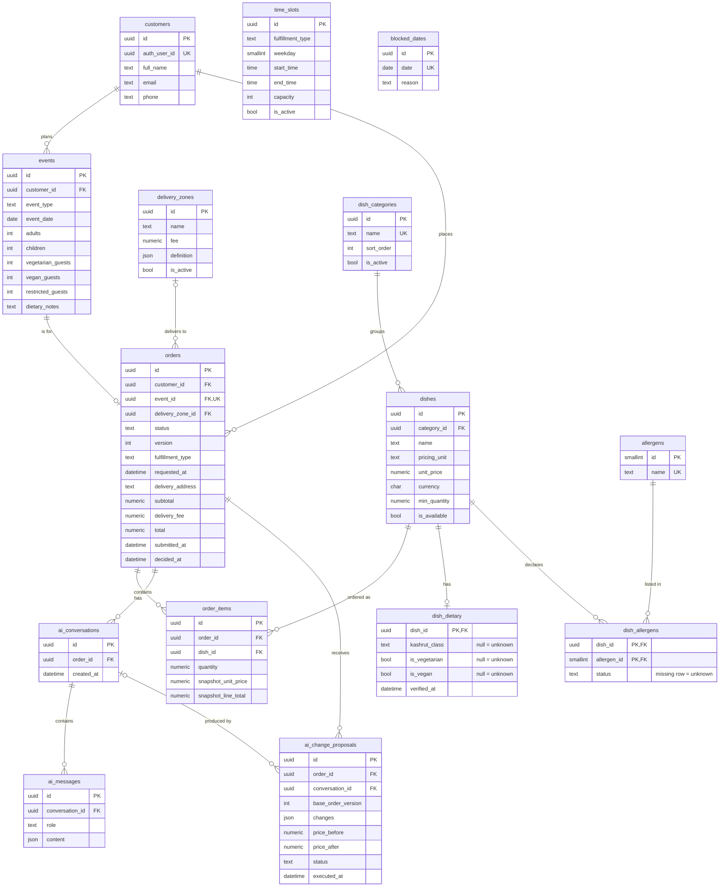

# Entity-relationship diagram

Generated by hand from `backend/app/models/entities.py` (SQLAlchemy). Column details and rules
live in `DATABASE_SCHEMA.md`. `time_slots` and `blocked_dates` have no foreign keys yet.

