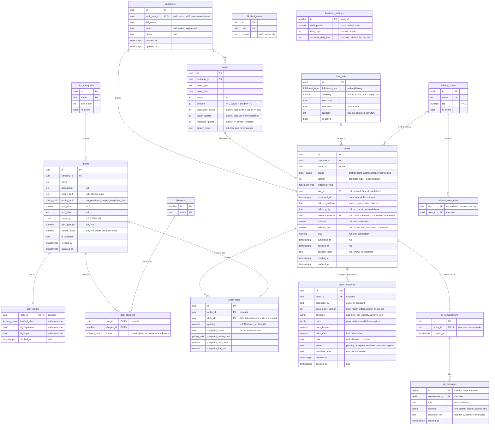

# Entity-Relationship Diagram

Status: matches migrations `0001`–`0010` and `backend/app/models/`. **Update this file in the same PR as every new migration.** Column-level notes and rationale live in [DATABASE_SCHEMA.md](DATABASE_SCHEMA.md).

Postgres types are shown. Local/test SQLite stores uuids as `char(32)` and enums as `varchar`. Every table has RLS enabled with no policies, because only the backend's privileged connection reads and writes (ADR 0002).

## Implemented

### Rules the diagram can't show
- **Unknown is not "no".** A `null` dietary field or a missing `dish_allergens` row means *unknown*. It is shown as unknown and never treated as safe.
- **Price snapshot.** While an order is `draft`, prices are read live from `dishes`. From `pending_approval` on, the `snapshot_*` columns are authoritative.
- **Status transitions** (enforced in services, with atomic conditional updates): `draft → pending_approval` (customer), then `pending_approval → approved | rejected` (owner). Anything else returns `409 invalid_transition`.
- **Ownership.** Customer access is always resolved from the verified token's `sub` → `customers.auth_user_id` (ADR 0005), never by email.
- **Guest groups are subsets** (OPEN_DECISIONS #4, decided 2026-11-02). Vegetarian, vegan and restricted guests are counted within adults + children. Vegetarian and vegan are **separate** groups, so vegetarian + vegan ≤ adults + children.
- **Pricing** (#14, #17, #18). Prices are in ILS, VAT included, and weight prices are per kg. Each line is rounded half-up to the agora, and the total is the sum of the lines.
- **Recommendations** (#3). A dish's quantity = eligible guests' portions ÷ `serves_adults`, rounded up (0.5 kg steps for weight, whole units otherwise) and never below `min_quantity`.
  - A child counts as `business_settings.child_portion` of an adult.
  - A vegan dish suits everyone. A vegetarian dish suits everyone except vegans. Any other dish, including one with unknown dietary data, excludes vegetarians and vegans.
- **`business_settings`** is a single, unrelated row of owner-editable settings.
- **Delivery fee** (#19). While draft, the fee is the current fee of the active zone containing `delivery_city`. At submission it is frozen into `orders.delivery_fee`, and `total` = sum of lines + fee.
- **Proposals** (#6). At most one `pending` per order (partial unique index). Accepting an owner proposal writes its frozen lines into `order_items`, recomputes the totals with the frozen delivery fee, and sets `orders.status = approved` and `decision_note = note`, all in one transaction guarded by `base_order_version`.
- **Assistant proposals** (Phase 4) use the same table with `proposed_by = assistant`, only on drafts, at live catalog prices. A new one cancels the open one; accepting one writes the items and bumps `version` but keeps the order `draft`. Submitting or withdrawing an order expires any open proposal.
- **Assistant messages** are stored exactly as exchanged with the model and never edited. The daily limit counts `ai_messages` with `customer_text` across the customer's orders in the last 24 hours.
- **Capacity** (#5). Orders that are `pending_approval` or `approved` hold their slot on their event date. Submitting checks `count < time_slots.capacity` while the slot row is locked (`SELECT … FOR UPDATE`).

## Planned (not migrated yet)

Nothing at the moment.
