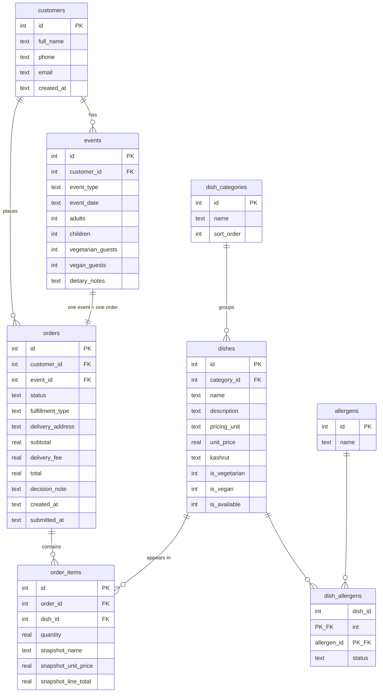

# ERD: local SQLite schema (lesson 15 homework)

Source of truth: `database/schema.sql`. Rendered diagram: `docs/erd.svg` (also `docs/erd.png`). The mermaid block below renders on GitHub.
This is the SQLite subset of `DATABASE_SCHEMA.md` (the Supabase/Postgres draft):
the core an order needs, plus allergens. Delivery zones, time slots, blocked dates
and the AI conversation tables are left for the Supabase phase.

## Relationship notes
- One customer, many events and many orders. The foreign key sits on the "many" side.
- One event has exactly one order (`orders.event_id` is a foreign key **and** unique).
- `order_items` resolves the many-to-many between orders and dishes. It also snapshots
  the dish name and unit price at submission, so later menu changes never rewrite
  an old order.
- `dish_allergens` resolves the many-to-many between dishes and allergens. Its primary
  key is the pair `(dish_id, allergen_id)`. A row says `contains` or `free`;
  a missing row means **unknown**, which the UI must never show as "free".
- Boolean columns use `1 / 0 / NULL`, and `NULL` means unknown, never "no".
