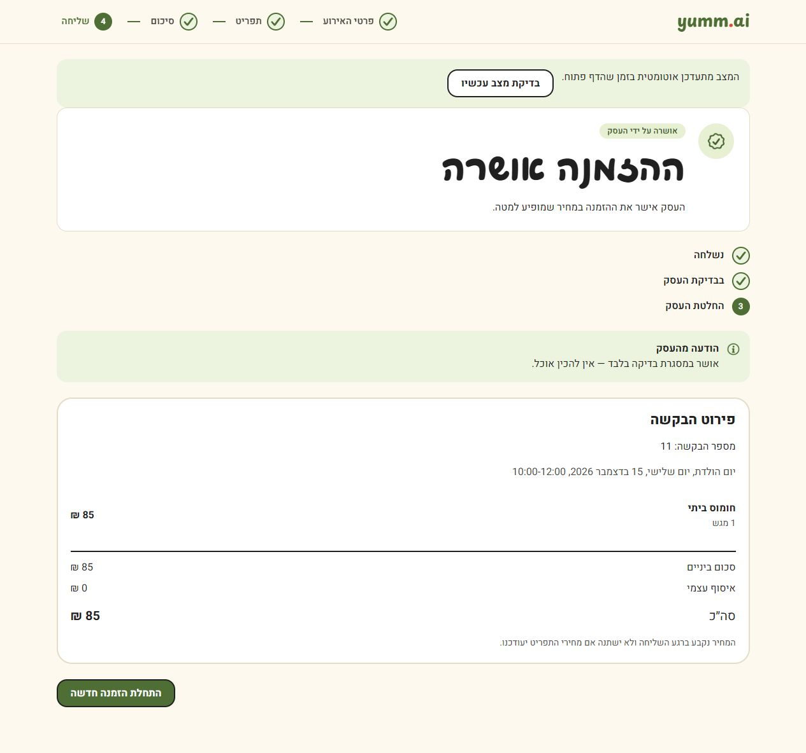
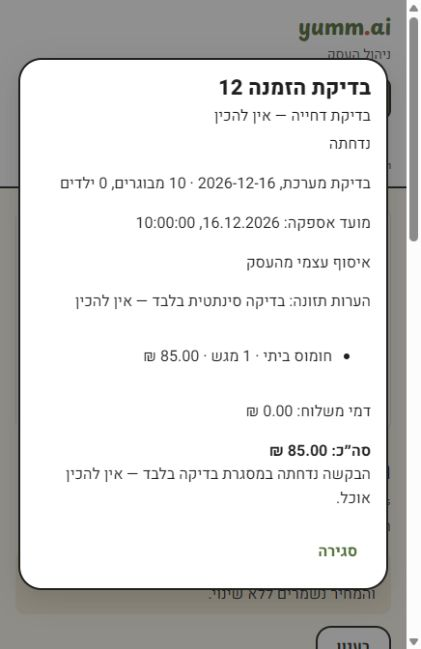

# Owner decisions

The owner can open an order from the administration table, review its event, fulfillment details, frozen items and price, and approve or reject it with an optional customer-visible message. This is a terminal decision in this phase; changing items or reopening a decided order is outside the workflow.

## Data and authorization

The browser sends the owner's access token to the application server. The server asks Supabase Auth for the current user and checks the server-controlled owner role. It does not trust a decoded token or customer-editable metadata. Customer receipt tokens cannot authorize decisions. Missing/invalid credentials fail closed, including when using SQLite locally.

The write compares the submitted version and pending status atomically, increments the version once, and stores the timestamp and note. A repeat of the same decision with the original version and same trimmed note returns the saved result. Conflicting decisions return 409. After an uncertain response, the dialog retains the original payload for retry; after a conflict it requires reopening the refreshed order.

The new cloud migration adds only a server-only function and column-level update rights for the service role. It does not add tables, rewrite historical migrations, or change browser RLS access. Existing order data is not backfilled. Price, item, event and submission data are not modified by a decision.

## Customer view

The receipt endpoint returns the latest status, version and owner note alongside the frozen submission snapshot. While pending and visible, the page checks every 15 seconds. Returning to the tab and the manual check button also refresh it. Failed requests retain the previous receipt with an explicit warning; late responses cannot restore a previous order or replace a newer version.

The existing receipt capability remains local to the customer's browser. Cross-device recovery and email/SMS notifications are future work.

## Verification

Verified 8 November 2026 on the Frankfurt catering project, `vbechymjcdlztoissafv`.

- 166 backend tests and 93 frontend/admin tests passed. Backend lint and formatting of the changed application/test files passed.
- The local PostgreSQL rehearsal and focused decision RPC suite passed: service-only execution, limited writable columns, migration preservation, approve/reject/retry/conflict behavior, frozen customer receipts and database close/reopen persistence.
- Migration `20261108184638_owner_order_decision.sql` was deployed through the scoped CLI. All five local/cloud migration versions match. Only this new migration was applied, without seed or vault changes.
- Synthetic order **11** was approved through the signed-in owner UI; **12** was rejected. Both advanced from version 1 to 2 and retained the original **85 ILS** total. The customer page for 11 displayed the approval and owner note; the private customer receipt for 12 returned the rejection and its note. Wrong customer capabilities and missing/invalid owner credentials were refused.
- Restarted the application after both decisions (process 57288 replaced by 28492), reloaded both interfaces, and repeated cloud/receipt comparisons. Both decisions persisted. Every non-decision order field and every original line item in the two test orders stayed unchanged.
- All original rows in eight core tables matched the private pre-change export, including the original six orders **1, 2, 3, 8, 9, 10**. The only added business records are those for the two clearly marked synthetic test orders; they must not be prepared.
- Customer capabilities, credentials and private backups are excluded from this repository. Hosted database shutdown was not performed; database close/reopen was exercised locally and hosted persistence was checked across application restart.

Claude Code implemented and tested the backend/RPC in an isolated checkout. Codex implemented the owner/customer UI, reviewed and integrated the backend, deployed the migration, and performed hosted preservation and restart checks.

