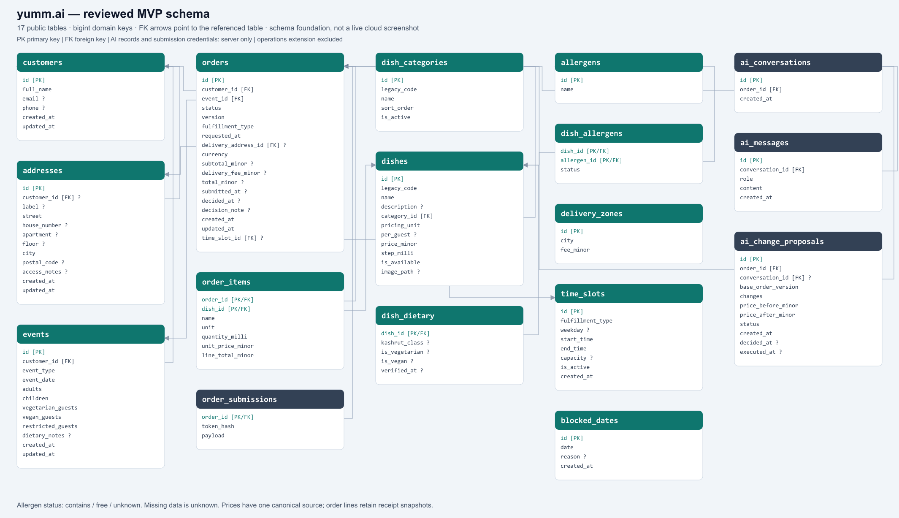

# Jonathan review follow-up

Review source: [Slack reply, 5 November 2026](https://aidev15.slack.com/archives/D0BUNABQSMU/p1793901998845739).

| Requested correction | Result |
| --- | --- |
| Normalize menu properties instead of JSON and duplicate prices | Typed dishes, categories, dietary rows, allergens and per-dish allergen status. Only `price_minor` is authoritative; order lines keep historical quote prices. |
| Separate broad course operations from the MVP | New MVP installs omit employees, deliveries, payments and stock. Their migrations, repositories and tests are preserved for a separate optional extension. Existing rows are never deleted by the MVP upgrade. |
| Add conversation/proposal and availability entities | Five Postgres tables plus the optional order/time-slot link, ownership constraints and restricted grants. These are schema foundations, not implemented AI execution or scheduling enforcement. |
| Consistent identifiers | Every public domain primary/foreign key is bigint; hashed submission tokens and dish codes are unique compatibility attributes, not entity identities. SQLite uses integer keys. |

## Data preservation and security

Historical catalog metadata is retained in a private migration snapshot. Missing allergen information, including historical empty arrays, remains unknown. `free` requires an explicit per-allergen declaration. Existing dish codes/media paths and customer receipt tokens continue to work after the ID migration.

Only server-controlled owner claims authorize browser access. AI transcripts/proposals and submission credentials remain server-only. No server credential is included in the repository or browser bundle.

## Verified locally

Final combined run: **96 backend tests**, **80 frontend/admin tests**, Ruff, SQL parsing,
fresh/legacy PostgreSQL catalog checks and actual legacy SQLite upgrade preservation passed.
The static explorer bundle passed JavaScript syntax validation. The rendered diagram shows
17 tables and 17 foreign-key constraints and was visually inspected.

- Fresh PostgreSQL migration sequence, normalized catalog and owner RLS.
- Customer RPC submission, replay, conflicts, token isolation and failure rollback.
- Saved receipt remains identical after closing and reopening a disk-backed database.
- Actual legacy SQLite migrations upgrade without losing the receipt, token, prices or an optional employee row.
- Optional extension: 54 SQLite behavior tests; PostgreSQL installation, preservation and owner access.

PGlite uses Auth and Storage stubs; these results do not establish hosted Storage/Realtime or multi-connection concurrency. The historical cloud screenshots in PR #37 predate this revision.

## Deployment boundary

The four reviewed migrations were **deployed on 5 November 2026** to `yumm.ai` in Frankfurt (`vbechymjcdlztoissafv`). A hosted rollback rehearsal passed before the atomic deployment. All 16 original tables were backed up privately and compared inside the deployment transaction; all five original orders and both saved receipts survived unchanged. No cloud reset or data deletion was performed.

The matching local server was restarted twice. Existing order 8 and new synthetic order 10 returned identical receipts after restart, and the signed-in owner admin displayed all six orders. See [cloud verification](CLOUD_UPGRADE_VERIFICATION.md) for evidence and limitations. CLI authentication and migration-history reconciliation remain outstanding; do not run an automatic CLI push/reset.

The previous complete implementation remains recoverable at commit `f34cb219efcb8f71007be9980cfdfa1c60a99036`.

The optional operations package is now isolated in draft [PR #56](https://github.com/JonathanZouari/ai-catering-platform/pull/56).
It does not automatically install tables; activation and operations UI integration remain separate.

