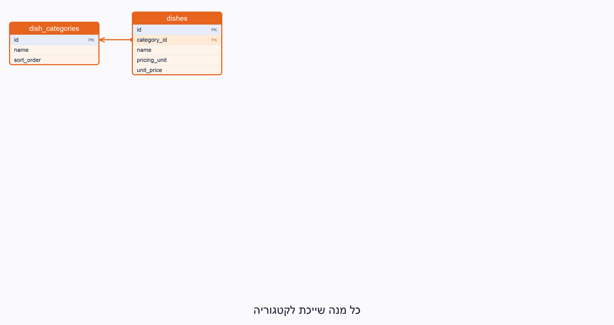

# SQLite Schema

A SQLite port of the draft schema in [DATABASE_SCHEMA.md](DATABASE_SCHEMA.md), for local development and testing.

- `database/sqlite/schema.sql` — creates all 15 tables.
- `database/sqlite/seed.sql` — **sample data only** (invented dishes, prices and zones).

- `database/sqlite/build_db.py` — builds a database from the two files above.

Build a database:

```sh
python database/sqlite/build_db.py              # creates database/sqlite/catering.db
python database/sqlite/build_db.py --no-seed    # schema only
```

Or with the `sqlite3` CLI:

```sh
sqlite3 catering.db < database/sqlite/schema.sql
sqlite3 catering.db < database/sqlite/seed.sql
```

Tests: `backend/tests/test_sqlite_schema.py` (run `uv run pytest` in `backend/`).



## Differences from the PostgreSQL draft

| PostgreSQL | SQLite |
|---|---|
| enum types | `TEXT` with `CHECK (... IN (...))` |
| `uuid` | `TEXT`, default `lower(hex(randomblob(16)))` |
| `timestamptz` | `TEXT` in ISO-8601 |
| `bool` | `INTEGER` 0/1 with `CHECK` |
| `jsonb` | `TEXT` with `CHECK (json_valid(...))` |

## Tables

| Table | Holds | Group |
|---|---|---|
| `dish_categories` | Menu categories | Catalog |
| `dishes` | Menu items with price and pricing unit | Catalog |
| `dish_dietary` | Kashrut / vegetarian / vegan per dish (`NULL` = unknown) | Catalog |
| `allergens` | List of allergens | Catalog |
| `dish_allergens` | Allergen status per dish (missing row = unknown) | Catalog |
| `delivery_zones` | Delivery areas and fees | Operations |
| `time_slots` | Pickup / delivery windows | Operations |
| `blocked_dates` | Days the business is closed | Operations |
| `customers` | Customers | Orders |
| `events` | A customer's event (guests, date, dietary counts) | Orders |
| `orders` | Order with status, totals and fulfillment | Orders |
| `order_items` | Dishes in an order, with price snapshot on submission | Orders |
| `ai_conversations` | Assistant conversation for an order | AI |
| `ai_messages` | Messages in a conversation | AI |
| `ai_change_proposals` | Changes the assistant proposes to an order | AI |

`time_slots` and `blocked_dates` have no foreign keys.

## Relationships (foreign keys)

Each row reads: *child table* → column → *parent table*.

| Child table | Column | Parent table | On parent delete |
|---|---|---|---|
| `dishes` | `category_id` | `dish_categories` | no action |
| `dish_dietary` | `dish_id` | `dishes` | cascade |
| `dish_allergens` | `dish_id` | `dishes` | cascade |
| `dish_allergens` | `allergen_id` | `allergens` | no action |
| `events` | `customer_id` | `customers` | no action |
| `orders` | `customer_id` | `customers` | no action |
| `orders` | `event_id` | `events` | no action |
| `orders` | `delivery_zone_id` | `delivery_zones` | no action |
| `order_items` | `order_id` | `orders` | cascade |
| `order_items` | `dish_id` | `dishes` | no action |
| `ai_conversations` | `order_id` | `orders` | cascade |
| `ai_messages` | `conversation_id` | `ai_conversations` | cascade |
| `ai_change_proposals` | `order_id` | `orders` | cascade |
| `ai_change_proposals` | `conversation_id` | `ai_conversations` | no action |

## Rules enforced by the database

| Rule | Where |
|---|---|
| Adults + children must be greater than 0 | `events` |
| Price and fee cannot be negative; quantity must be positive | `dishes`, `delivery_zones`, `order_items` |
| A delivery order must have an address | `orders` |
| `end_time` must be after `start_time` | `time_slots` |
| One dish per order (no duplicate lines) | `order_items` |
| One order per event | `orders` |
| At most one `pending` change proposal per order | `ai_change_proposals` |
| Draft orders read live prices; price columns are filled on submission | `orders`, `order_items` |
