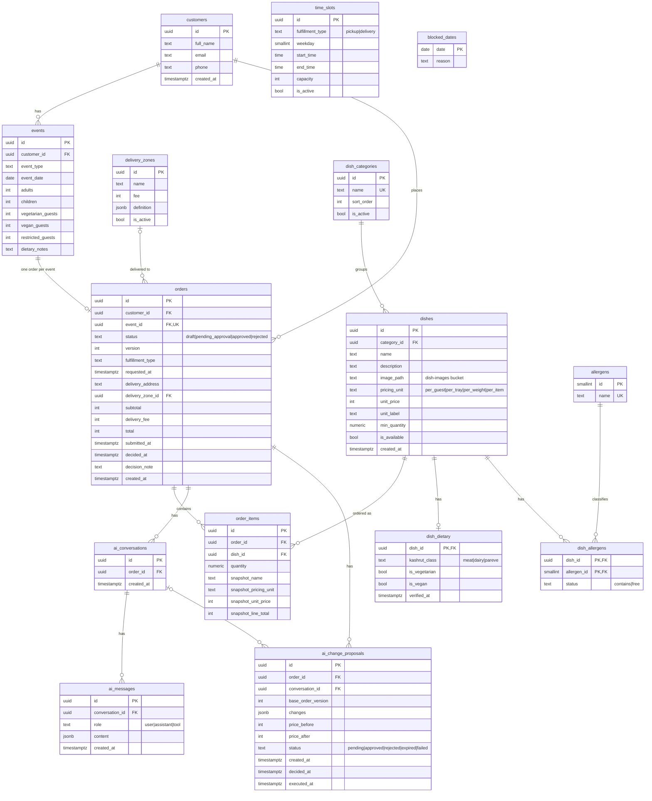

# ERD — Supabase (project `ai-catering-platform`, schema `public`)

Source of truth: `supabase/migrations/20261105000000_init.sql`. Money = integer agorot. NULL in dietary/allergen columns = unknown, never "no".

`time_slots` and `blocked_dates` have no foreign keys: they are availability rules the backend checks against `orders.requested_at`.
Unique `(order_id, dish_id)` on `order_items`; at most one `pending` proposal per order (partial unique index).

## Cloud setup (Supabase project `ai-catering-platform`, ref `bbefeovnviriretrdlxl`, eu-central-1)

- **Schema:** 15 tables, migrations in `supabase/migrations/` (copies in `database/migrations/`).
- **Seed:** `supabase/seed.sql` (catalog + 3 demo customers), `supabase/seed_demo_more.sql` + `fix_totals.sql` (5 more customers, orders, one AI proposal). 8 fictitious customers in total.
- **Storage:** public-read bucket `dish-images` (JPEG/PNG/WebP, max 5MB); writes only for admin.
- **Auth + RLS:** email/password login. RLS on every table. Catalog is public-read; customers see only their own events/orders (editable while `draft`); admin = `app_metadata.role = 'admin'` (full access). `customers.auth_user_id` links a customer to `auth.users`.
- **Realtime:** `orders`, `order_items`, `ai_change_proposals`, `ai_messages`, `dishes` are in the `supabase_realtime` publication.
- **Demo users** (password shared privately, not in the repo): `admin.demo@example.com` (admin), `dana.demo@example.com` (customer, owns a draft order).
