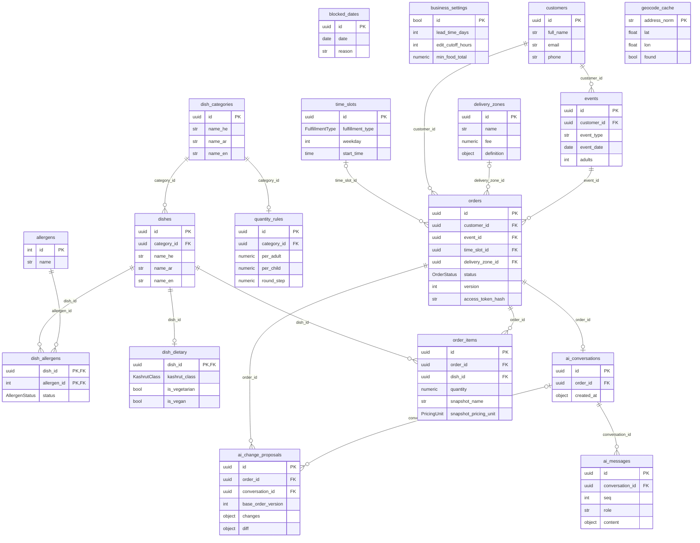

# CaterKing database: ERD

18 tables in four groups. The diagram is generated from the SQLAlchemy models by `scripts/erd.py`, so it always matches the code. It shows keys plus a few columns per table; full columns are in [DATABASE_SCHEMA.md](../DATABASE_SCHEMA.md).

| Group | Tables |
|---|---|
| Menu | `dish_categories` → `dishes` → `dish_dietary` (1:1), `dish_allergens` (many-to-many with `allergens`), `quantity_rules` (1 per category) |
| Ordering | `customers` → `events` → `orders` → `order_items` → `dishes` |
| Logistics | `time_slots`, `delivery_zones` (both optional on an order), `blocked_dates`, `geocode_cache` |
| AI assistant | `orders` → `ai_conversations` (1:1) → `ai_messages`; `ai_change_proposals` (per order, optional conversation) |
| Settings | `business_settings` (one row) |

`||` = exactly one, `|o` = zero or one, `o{` = zero or more.



## Try it in SQLite

```bash
cd backend
DATABASE_URL=sqlite:///./caterking_dev.db uv run python -m app.migrate     # tables + allergens + settings
sqlite3 caterking_dev.db < ../database/sqlite/demo_seed.sql                # demo menu and one order
sqlite3 -header -column caterking_dev.db                                   # explore
```

The demo seed adds 3 categories, 7 dishes (he/ar/en), dietary rows, allergens, 2 time slots, a delivery zone, a blocked date, and one customer with an event and an order waiting for approval.

One order across five tables (`orders` → `customers`, `events`, `order_items` → `dishes` → `dish_categories`):

```sql
SELECT c.full_name AS customer, e.event_type AS event, e.event_date AS date, o.status,
       d.name_en AS dish, cat.name_en AS category, i.quantity AS qty, i.snapshot_line_total AS line_total
FROM orders o
JOIN customers c ON c.id = o.customer_id
JOIN events e ON e.id = o.event_id
JOIN order_items i ON i.order_id = o.id
JOIN dishes d ON d.id = i.dish_id
JOIN dish_categories cat ON cat.id = d.category_id;
```
```
customer       event     date        status            dish            category  qty  line_total
-------------  --------  ----------  ----------------  --------------  --------  ---  ----------
דנה כהן (דמו)  birthday  2026-11-16  pending_approval  Schnitzel       Mains     3    360       
דנה כהן (דמו)  birthday  2026-11-16  pending_approval  Garden salad    Salads    2    180       
דנה כהן (דמו)  birthday  2026-11-16  pending_approval  Chocolate cake  Desserts  1    85
```

The many-to-many link between dishes and allergens (a missing row means *unknown*, never "free"):

```sql
SELECT d.name_en AS dish, a.name AS allergen, da.status
FROM dish_allergens da
JOIN dishes d ON d.id = da.dish_id
JOIN allergens a ON a.id = da.allergen_id
ORDER BY d.name_en;
```
```
dish            allergen  status  
--------------  --------  --------
Chocolate cake  milk      contains
Chocolate cake  eggs      contains
Chocolate cake  gluten    contains
Garden salad    peanuts   free    
Hummus          sesame    contains
Schnitzel       gluten    contains
Schnitzel       eggs      contains
```

Regenerate the diagram after changing a model: `cd backend && PYTHONPATH=. uv run python ../scripts/erd.py`.
